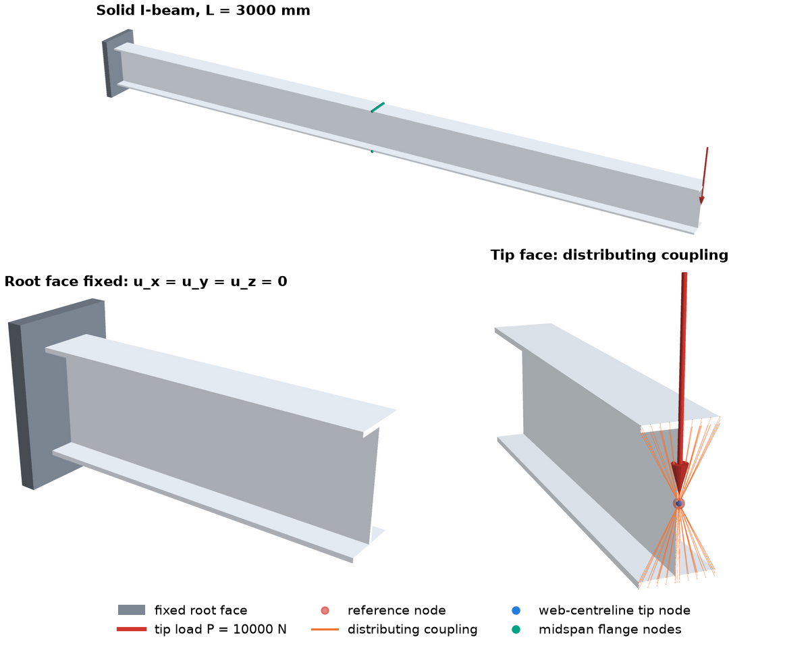
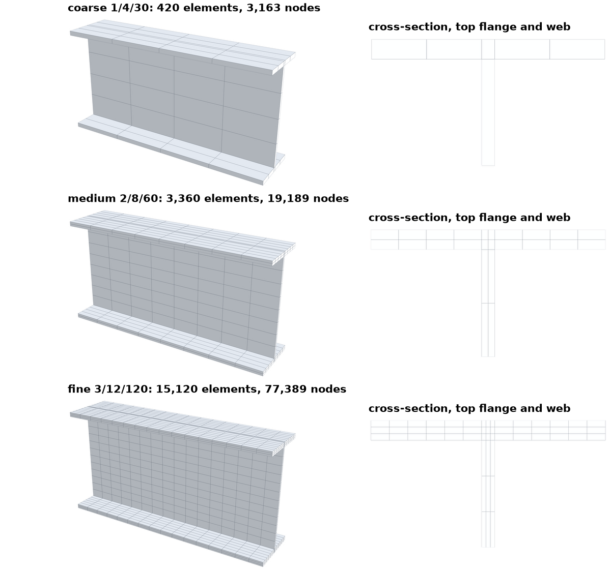
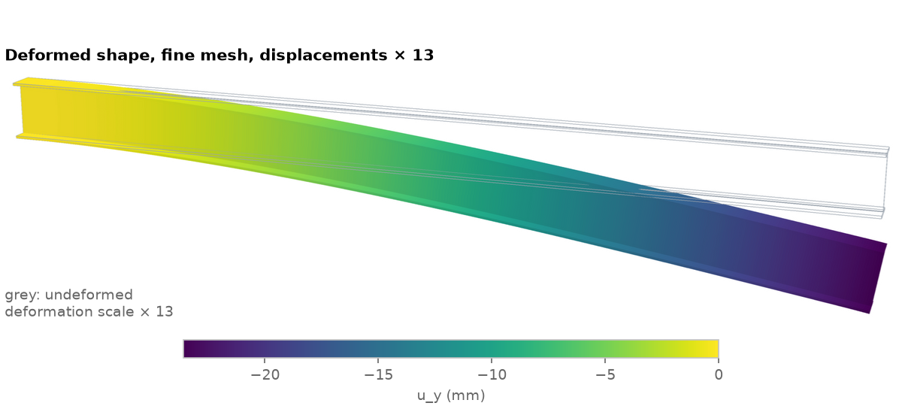
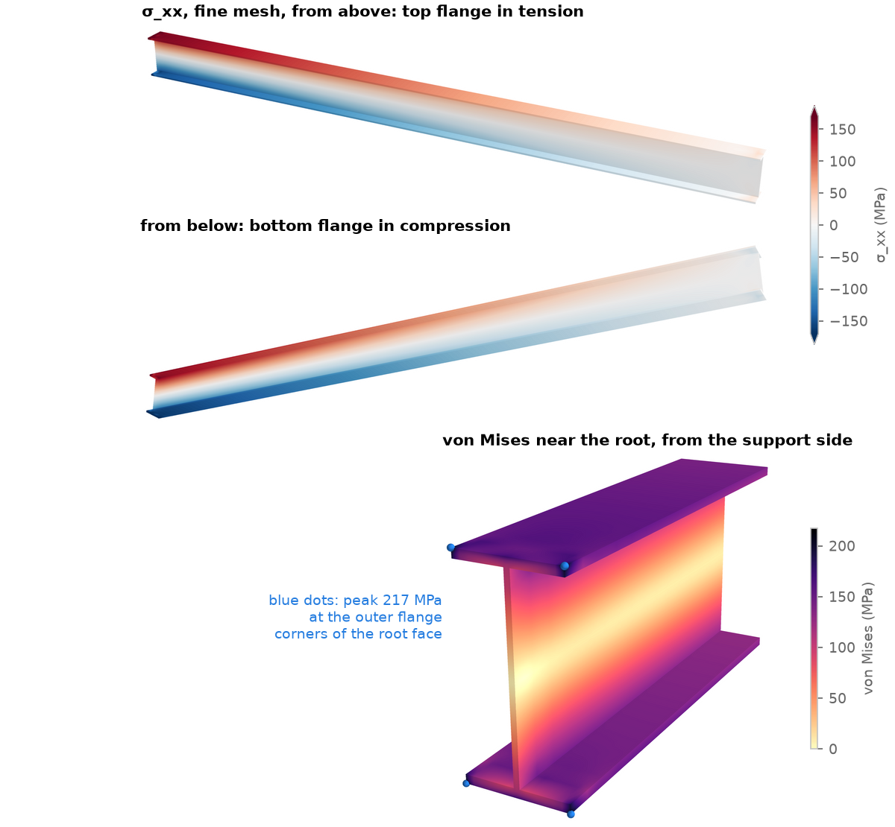
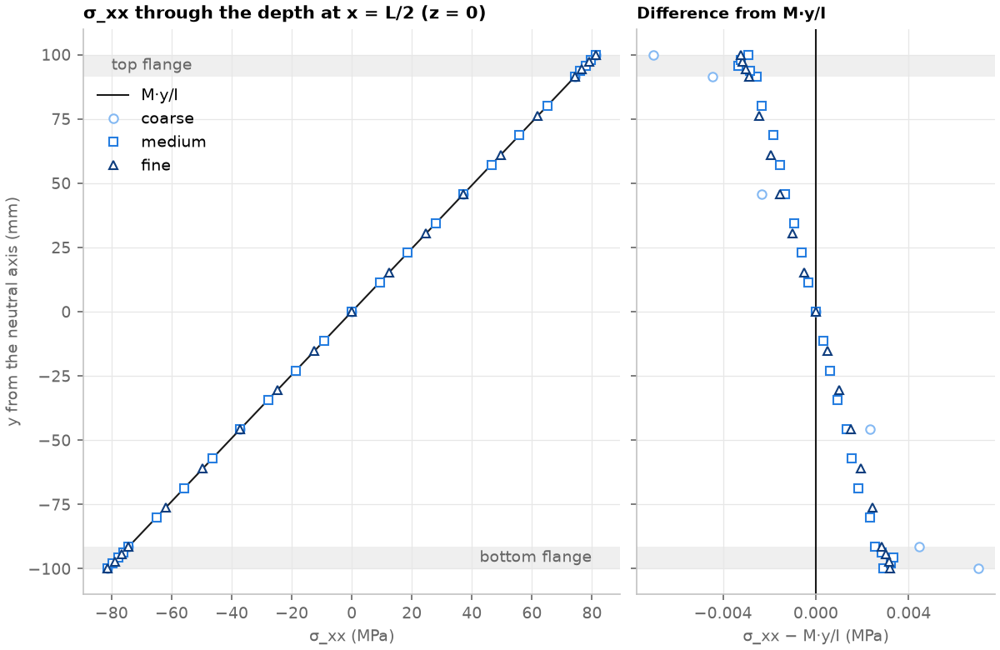

# IPE 200 cantilever benchmark figures

Generated by `python plots.py` from the solver output of `python benchmark.py`. Do not edit by hand. The numbers are in [REPORT.md](REPORT.md).

## Figure 1. Model and boundary conditions

The solid I-beam (coarse mesh), x along the beam, y up. The root face (x = 0, grey wall) is fixed in all three directions. The tip load P = 10000 N acts in −y on the reference node at the tip-face centroid, and the distributing coupling (orange) spreads it over every tip-face node without stiffening the face. The reference node is not in the `.frd`, so it is drawn at its position in the deck. The web-centreline tip node lies on the tip face at the same point, inside the reference-node marker; its deflection is compared with the reference node's. The midspan flange nodes (green, x = L/2) cover the outer surfaces of the top and bottom flanges, where the midspan stress is measured.

## Figure 2. Mesh levels

The mesh levels, labelled with the element counts through the flange thickness, along the web height and along the length (coarse 1/4/30, medium 2/8/60, fine 3/12/120). Left: the first 400 mm of the beam from the root face. Right: a close-up of the cross-section above y = 40 mm, seen along the beam axis (the section is symmetric about y = 0). The web thickness has as many elements as the flange thickness and each flange outstand twice as many. All elements are 20-node C3D20R bricks; their midside nodes are not drawn. The node counts are those in the `.frd`, without the reference node.

## Figure 3. Deformed shape

Deformed shape of the fine mesh coloured by the vertical displacement u_y, with displacements scaled × 13 so that the tip drop (23.60 mm, the largest |u_y|) shows as about 10 % of L. The grey outline is the undeformed beam. u_y is zero at the fixed root face and grows towards the tip like the deflection curve of figure 5.

## Figure 4. σ_xx and von Mises stress

σ_xx on the fine mesh, seen from above and from below, with a diverging colour map centred on zero. The hogging moment puts the top flange in tension (red) and the bottom flange in compression (blue), largest at the root and falling linearly to zero at the tip. The colour range is ±170 MPa, just above the beam-theory root bending stress P·L·c/I = 162.5 MPa. Only nodes within 12 mm of the root face go beyond it, up to ±239 MPa. Bottom: von Mises stress in the first 400 mm, seen from the root face. The peak of 217 MPa (blue dots) is at the outer corners of the flanges on the root face, where the fixed face meets the free surfaces. That is the stress singularity of a fixed face, which grows with mesh refinement (figure 8), so the root stress is information only.

## Figure 5. Deflection along the beam

Downward deflection v(x) of the web-centreline nodes for each mesh level against the Euler-Bernoulli curve P·x²(3L − x)/(6EI) and the Timoshenko curve, which adds the shear term P·x/(κ·G·A_s). The FE curves lie on the Timoshenko curve along the whole beam, while the Euler-Bernoulli curve, which leaves out shear, ends 0.346 mm short at the tip. The lower panel shows the FE difference from Timoshenko: for the fine level at most 0.032 mm, 0.14 % of δ_T. The FE beam is slightly stiffer than Timoshenko theory with A_s = (h − t_f)·t_w and κ = 1. The difference drops quickly in the first 100 mm, where the fixed root face holds back the shear deformation that Timoshenko theory has from x = 0, then grows steadily along the beam and dips again in the last section depth, where the distributing coupling brings the load into the tip face. The diamond is the reference node's tip deflection from the `.dat`, the pass/fail value (-0.035 % against Timoshenko); it sits closer to Timoshenko than the web-centreline tip node because the coupling averages the tip-face motion.

## Figure 6. σ_xx through the depth at midspan

Nodal σ_xx at midspan (x = L/2) on the mid-plane z = 0, through the web and both flanges, for each mesh level against the linear beam-theory distribution M·y/I with M = P·L/2. The shaded bands are the flanges. Plane sections stay plane: σ_xx is linear in y, zero at the neutral axis and ±81.27 MPa at the outer fibres, tension at the top and compression at the bottom under the hogging moment. The fine level differs from M·y/I by at most 0.003 MPa (right panel).

## Figure 7. σ_xx along the top flange

Nodal σ_xx on the outer surface of the top flange (y = h/2), averaged across the flange width at each node plane, for each mesh level against the linear moment diagram σ = P·(L − x)·c/I. More than one section depth (h = 200 mm, shaded) from either end the fine level differs from beam theory by at most 0.03 MPa. The shaded St-Venant zones are where the end conditions disturb the beam-theory stress. At the root the fixed face stops the lateral (Poisson) contraction and the stress is singular where it meets the free surfaces, so the flange stress at x = 0 rises with refinement (177 → 184 → 195 MPa against P·L·c/I = 162.5 MPa) and undershoots just behind it. At the tip the distributing coupling brings the load in over the tip face, which adds a local σ_xx of up to 22 MPa where beam theory has almost none.

## Figure 8. Convergence against mesh size

Convergence against node count (log scale), one point per mesh level. Left: the signed errors of the three pass/fail quantities against their targets, inside the shaded ±2 % pass band. Middle: the same errors close up. Every level is within 0.043 % of its target, so the results are stable under refinement; the top- and bottom-flange stress errors are equal and their markers overlap. Right: the root peak von Mises stress grows with every refinement (170 → 192 → 217 MPa) and moves away from the beam-theory root bending stress P·L·c/I = 162.5 MPa. That is the expected stress singularity where the fixed root face meets the free surfaces, which is why the root stress is information only and does not enter the verdict.
