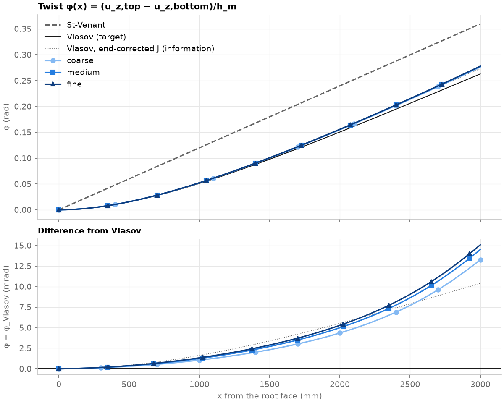
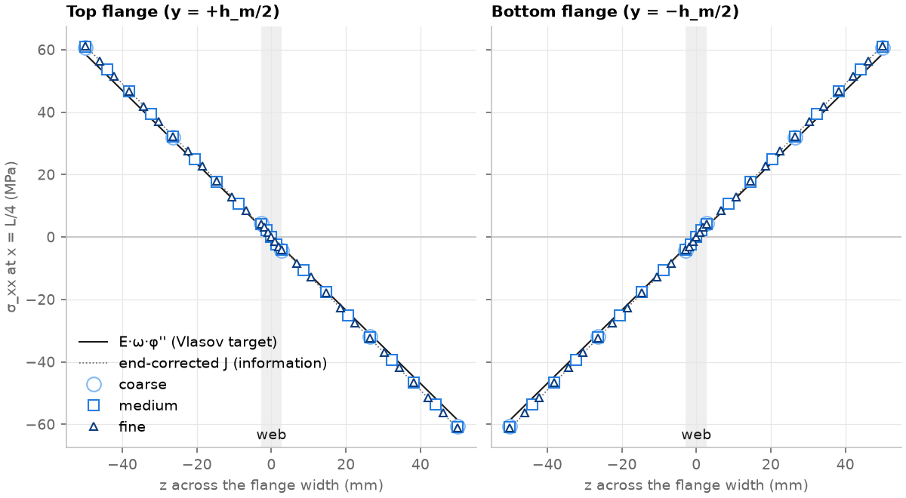
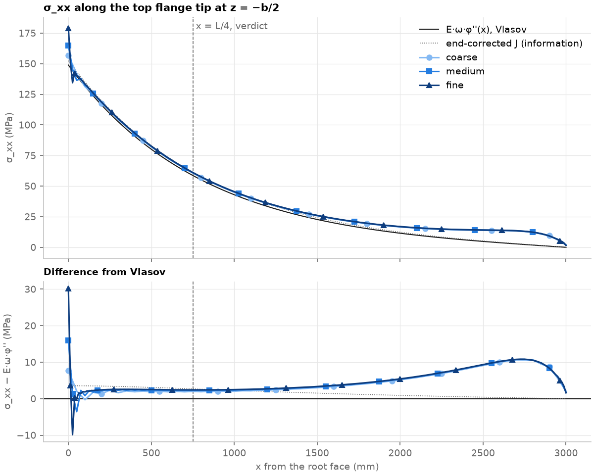
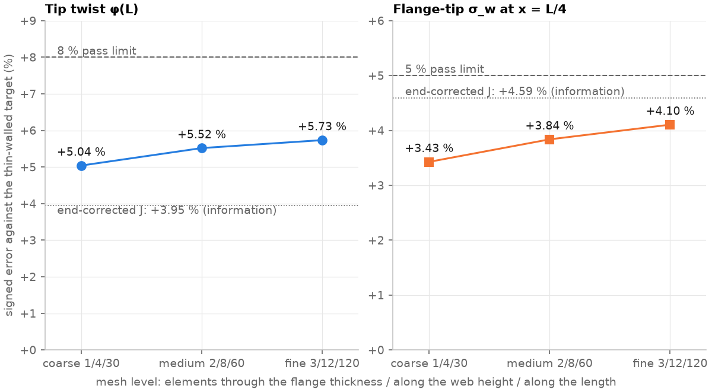
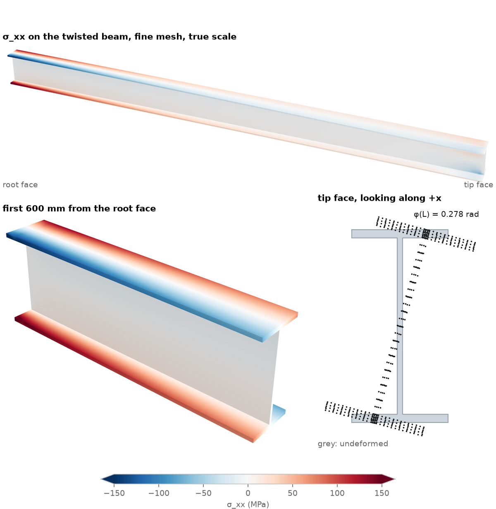

# IPE 200 cantilever in torsion benchmark figures

Generated by `python plots.py` from the solver output of `python benchmark.py`. Do not edit by hand. The numbers are in [REPORT.md](REPORT.md).

## Figure 1. Twist along the beam

Twist φ(x) from the flange mid-plane centre nodes at every x station, for each mesh level, against the Vlasov curve of mixed torsion (the target, root warping-restrained and tip free to warp) and the pure St-Venant line T·x/(GJ). Restraining warping at the root stiffens the beam: the Vlasov tip twist is 0.2627 rad, 73 % of the St-Venant 0.3595 rad. Near the root φ grows slowly, because warping carries most of the torque there, and towards the tip it runs parallel to the St-Venant line. The FE curves of the three levels nearly coincide and lie above Vlasov; the lower panel shows the gap growing smoothly from the root to +15.1 mrad (+5.73 %) at the tip on the fine level, +3.0 % at midspan. Most of it is the thin-walled torsion constant, which leaves out the plate-end correction and so overstates the solid's St-Venant stiffness. The dotted line (information) is Vlasov with the end-corrected J = 49255 mm⁴, which ends at 0.2731 rad. The FE gap follows it up to about two thirds of the length and then grows past it, over the stretch where figure 3 shows the disturbance from the load introduction.

## Figure 2. σ_xx across the flanges at x = L/4

Nodal σ_xx across the width of the top and the bottom flange at x = L/4, the mean through the flange thickness at each z, for each mesh level, against the thin-walled warping stress σ_w = −E·y·z·φ''(L/4) on the flange mid-planes (y = ±h_m/2). It is linear across each flange, zero over the web (shaded) and opposite in sign on the two edges of a flange and on the two flanges: the + − − + pattern at the four flange tips. The torque turns the top flange towards +z, so its −z edge is in tension and its +z edge in compression. At the flange tips the fine level reads +61.09 and -61.09 MPa on the top flange, +4.10 % against ±58.68 MPa, the verdict values of REPORT.md. The levels agree to within a few tenths of a MPa. The dotted line (information) uses the end-corrected J, with ±61.37 MPa at the tips.

## Figure 3. Warping stress along the flange tip

Nodal σ_xx along the top flange-tip edge at z = −b/2, the mean through the flange thickness at each x station, for each mesh level, against the Vlasov warping stress E·ω·φ''(x) with ω = h_m·b/4. It is largest at the root, where the fixed face restrains warping, and decays along the beam with the length 1/λ = 809 mm. Three zones show:

- **Root.** At the root face itself the FE stress (156.6 → 164.9 → 179.0 MPa, coarse → medium → fine) grows with refinement beyond the thin-walled 148.84 MPa: the fixed face is singular at its edges, so the root value is information only.
- **Middle.** Between the root zone and x ≈ L/3 the FE curves follow Vlasov a few % above it, as in figure 2; at x = L/4 (dashed) this is the verdict value. The dotted end-corrected curve (information) is closer.
- **Towards the tip.** Instead of falling towards zero, the FE stress levels off at 12–17 MPa between x = 2000 and 2800 mm, where Vlasov drops to a few MPa (4.8 MPa at x = 2500, FE 14.1), and it returns near zero only at the tip face, which is free to warp. All three mesh levels agree, so it is not a discretisation error. The likely cause is the load introduction: the distributing coupling spreads the torque in proportion to the distance from the axis, which puts most of it into the flanges as lateral shear, while Vlasov carries it almost entirely as St-Venant shear at a free tip. In an open section that difference is not confined to a short zone but decays over a length of the order of 1/λ: on the fine level the FE stress is more than 2 % above the end-corrected curve from x = 1200 mm on, 1800 mm from the tip. At x = L/4 it is -0.47 % from the end-corrected curve.

## Figure 4. Convergence over the mesh levels

Signed errors of the two verdict quantities against their thin-walled targets, one point per mesh level; each level halves the element length along x (100 → 50 → 25 mm). The tip twist error runs +5.04 → +5.52 → +5.73 % and the flange-tip warping stress error at L/4 +3.43 → +3.84 → +4.10 % (the mean of the four flange tips, which agree by symmetry). Both sit inside their pass limits (dashed) from the coarse level on, and both grow slightly with refinement instead of shrinking towards zero: the coarse mesh is a little stiff in torsion, and the FE converges towards the solid section's own answer, not towards thin-walled theory. The dotted lines (information) mark where Vlasov with the end-corrected J lies against the targets, +3.95 % and +4.59 %: the end correction accounts for most of the gap, and REPORT.md lists the other sources.

## Figure 5. σ_xx on the twisted beam

Nodal σ_xx on the fine mesh, drawn on the deformed beam at true scale, with a diverging colour map centred on zero. Top: the whole beam, seen from above the +z side. The warping stress is largest at the root and fades along the length, with opposite signs on the two edges of each flange and on the two flanges. Bottom left: the first 600 mm. On the top flange the far edge (z = −b/2) is in tension (red) and the near edge (z = +b/2) in compression (blue); on the bottom flange it is the other way round: the + − − + pattern. Bottom right: the tip face looking along +x (from the root end, z to the right), the FE tip-face nodes in their deformed position over the undeformed section; the section turns by φ(L) = 0.278 rad (15.9°) about the x axis, the top flange towards +z. The colour range is ±150 MPa, just above the thin-walled root warping stress 148.8 MPa; only nodes within 12 mm of the root face go beyond it, up to ±213 MPa at the fixed face's edges.
