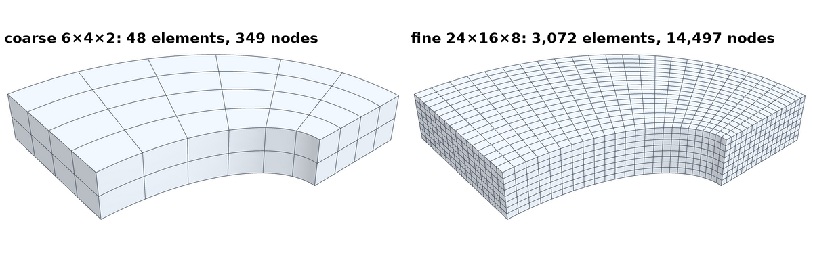
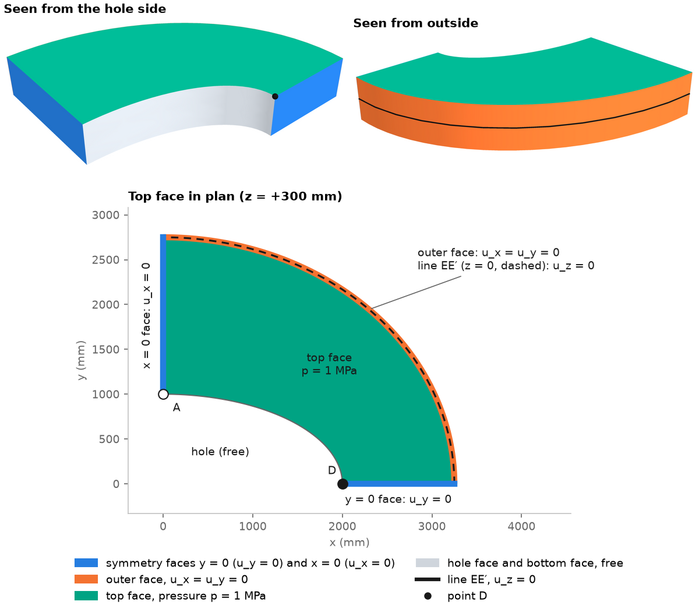
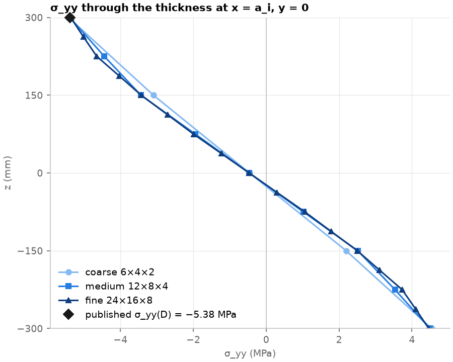
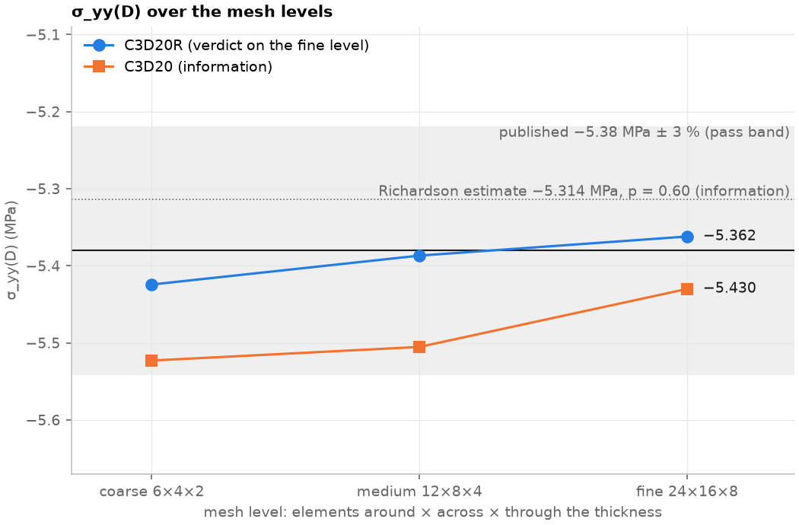
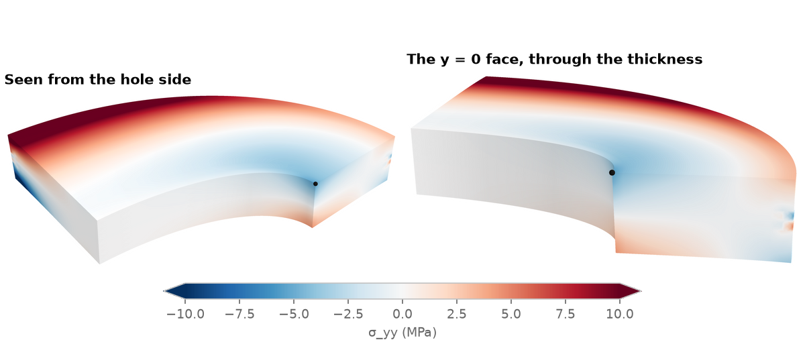
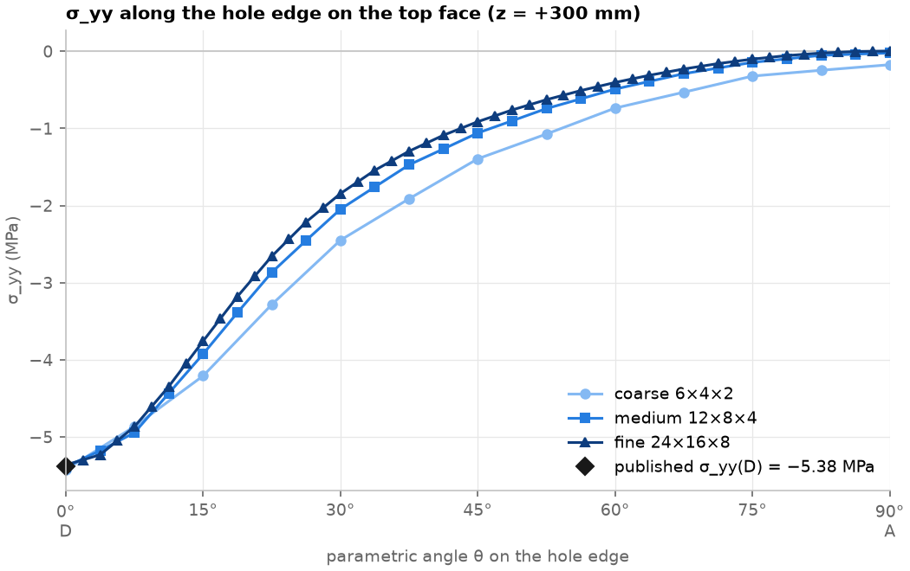
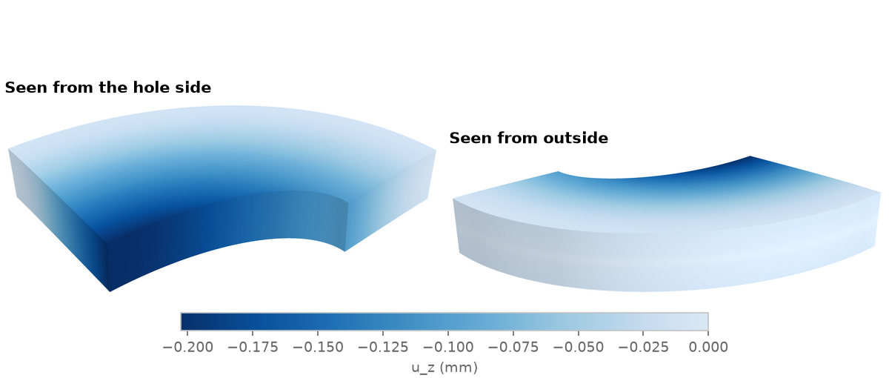
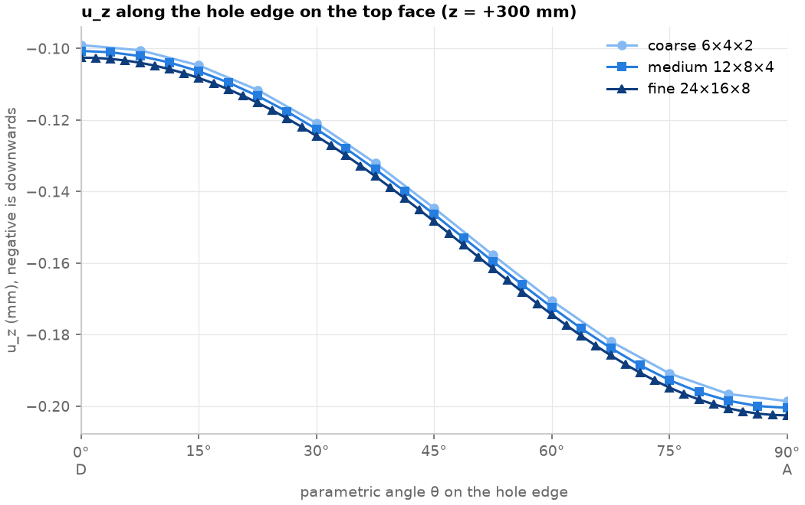

# NAFEMS LE10 thick plate benchmark figures

Generated by `python plots.py` from the solver output of `python benchmark.py`. Do not edit by hand. The numbers are in [REPORT.md](REPORT.md); the benchmark is described in [README.md](README.md).

## Figure 1. Mesh levels

The coarse 6×4×2 and fine 24×16×8 meshes, counted as elements around the annulus × across it × through the thickness, seen from the hole side above the plate: the x = 0 face on the left, the hole face in the middle and the y = 0 face on the right. Each line across the annulus joins the inner and outer ellipse at one parametric angle θ, (a cos θ, b sin θ), with uniform spacing, so the elements grow from the hole to the outer ellipse and from D (θ = 0) towards A (θ = 90°). All elements are 20-node bricks whose midside nodes sit on the ellipses, so each edge around the annulus is drawn as the quadratic curve through its midside node; the midside nodes themselves are not drawn. Each level halves the element size of the one before in all three directions.

## Figure 2. Supports and load

The supports and load of NAFEMS LE10 on the quarter model (coarse mesh). The two symmetry faces (blue) are held normal to themselves: u_y = 0 on the y = 0 face and u_x = 0 on the x = 0 face. The outer elliptical face (orange) is held in its plane, u_x = u_y = 0, and the plate rests on line EE′, the outer face at mid-thickness (z = 0), where u_z = 0 on every corner and midside node. A uniform pressure of 1 MPa pushes down on the top face (green, z = +300 mm). The hole face and the bottom face are free. Point D, where σ_yy is measured, is (2000, 0, +300) mm: on the hole edge, on the x axis, on the loaded face. Top left: seen from the hole side above the plate. Top right: seen from outside, with line EE′. Bottom: the top face in plan, z up out of the page.

## Figure 3. σ_yy through the thickness at D

Nodal σ_yy through the thickness at the hole edge on the x axis (x = a_i, y = 0), from the bottom face (z = −300 mm) to point D on the loaded top face (z = +300 mm), one marker per node, for each mesh level. The plate bends over the hole: σ_yy is compressive at the top and tensile at the bottom. At D it is −5.424 → −5.387 → −5.362 MPa (coarse → medium → fine) against the published −5.38 MPa (diamond), at the bottom face 4.541 → 4.491 → 4.461 MPa. On the fine level σ_yy changes sign at z = −23 mm.

## Figure 4. Convergence of σ_yy(D)

Nodal σ_yy(D) at each mesh level for C3D20R, which decides the verdict on the fine level, and for C3D20 (full integration, information only), against the published −5.38 MPa and its ±3 % pass band (shaded). C3D20R runs −5.424 (+0.82 %) → −5.387 (+0.13 %) → −5.362 (−0.33 %) MPa and C3D20 −5.523 (+2.66 %) → −5.505 (+2.33 %) → −5.430 (+0.93 %) MPa. The dotted line is the Richardson estimate from the three C3D20R levels, −5.314 MPa with the observed order p = 0.60 (information). That order is low, so the sequence is not yet in its asymptotic range and the estimate is not a reliable limit (see REPORT.md).

## Figure 5. σ_yy on the deformed plate

Nodal σ_yy on the fine mesh, drawn on the plate deformed 500 times true scale, with a diverging colour map centred on zero; the black dot is point D. Left: from the hole side above the plate. Right: the y = 0 symmetry face, with the hole face on its left and D at their shared top corner. Around the hole the plate bends over the support: σ_yy is compressive (blue) on the loaded top face at D, −5.36 MPa, and tensile (red) on the bottom face beneath it. Towards the outer face, which is held in its plane, the bending reverses, tension on the top and compression on the bottom. The specks at the right end of the y = 0 face, at mid-thickness on the outer face, are the singular line EE′. The colour range is ±10 MPa; only nodes on the top and bottom edges of the outer face with y ≥ 2068 mm go beyond it, up to −15.7 MPa at (x, y, z) = (0, 2750, −300) mm.

## Figure 6. σ_yy along the hole edge

Nodal σ_yy along the top-face hole edge from D (θ = 0°, on the x axis) to A (θ = 90°, on the y axis), against the parametric angle θ of the hole ellipse, (a_i cos θ, b_i sin θ), one marker per node, for each mesh level. At D the hole edge runs along y, so σ_yy is the hoop stress there, the verdict quantity (diamond: the published −5.38 MPa). Towards A the edge turns to run along x, so σ_yy becomes the stress normal to the traction-free hole face and falls to about zero (0.004 MPa at A on the fine level).

## Figure 7. u_z on the deformed plate

Out-of-plane displacement u_z on the fine mesh, drawn on the plate deformed 500 times true scale, darker where it moves further down. The plate rests on line EE′, at mid-thickness on the outer face, so u_z is zero on that line and the pressure pushes the plate down towards the hole, most at the hole face on the y axis near A: −0.203 mm at (x, y, z) = (0, 1000, +187.5) mm. Left: from the hole side above the plate. Right: from outside, with the outer face.

## Figure 8. u_z along the hole edge

Nodal out-of-plane displacement u_z along the top-face hole edge from D (θ = 0°) to A (θ = 90°), for each mesh level. The plate rests on line EE′, at mid-thickness on the outer face, so the pressure pushes the whole hole edge down. u_z is −0.0991 → −0.1007 → −0.1025 mm at D and −0.1986 → −0.2005 → −0.2026 mm at A (coarse → medium → fine).
