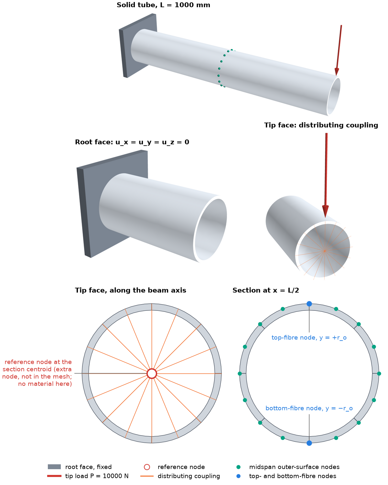
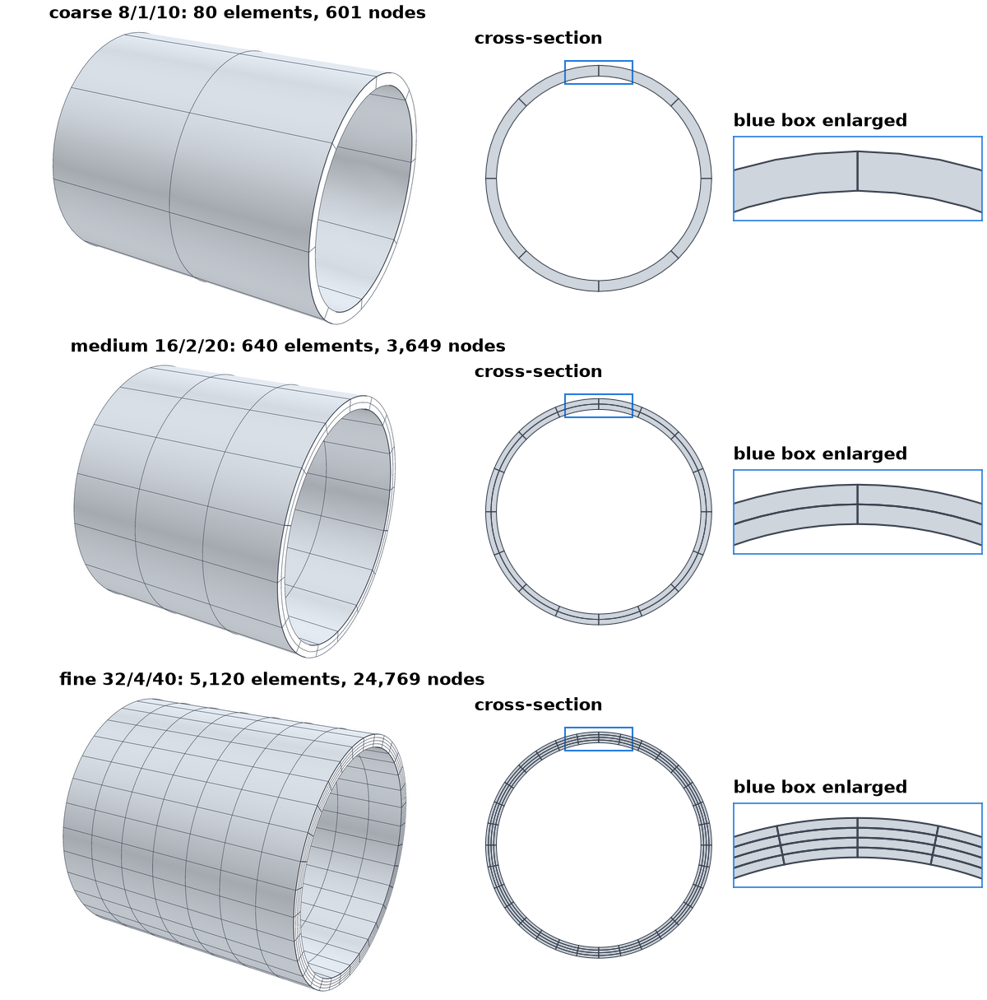
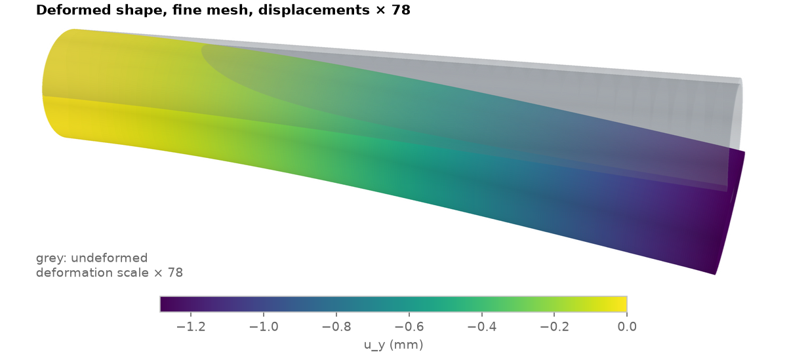
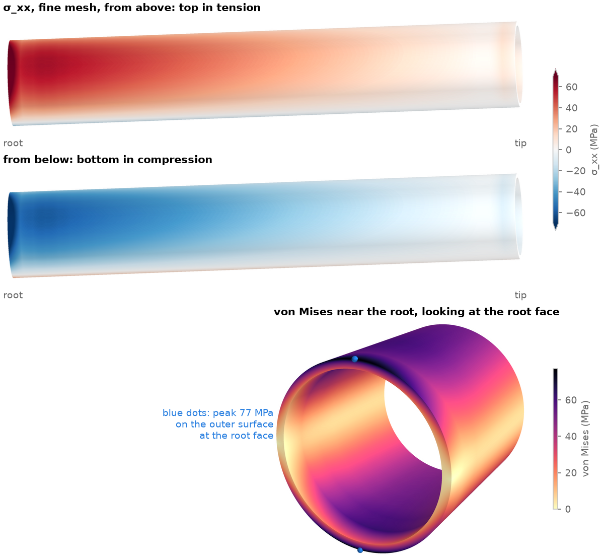
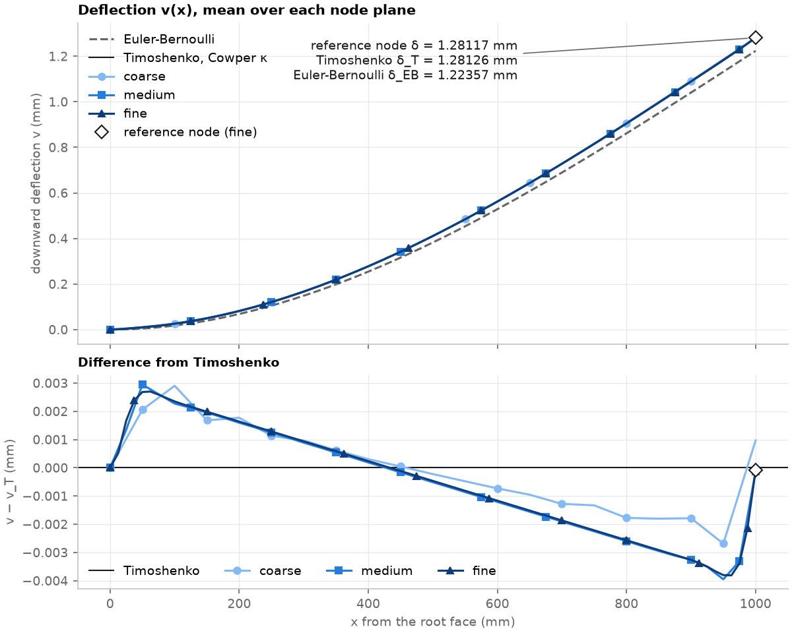
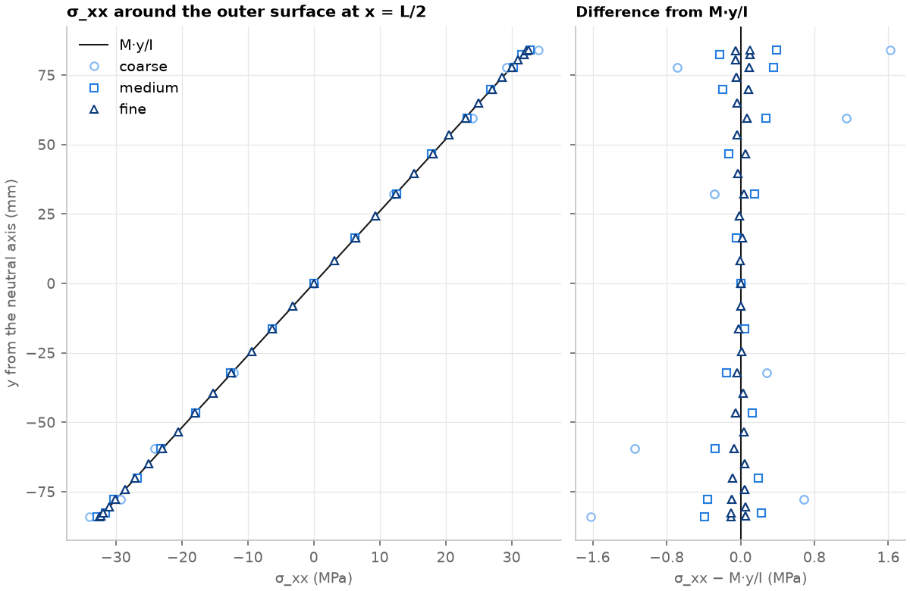
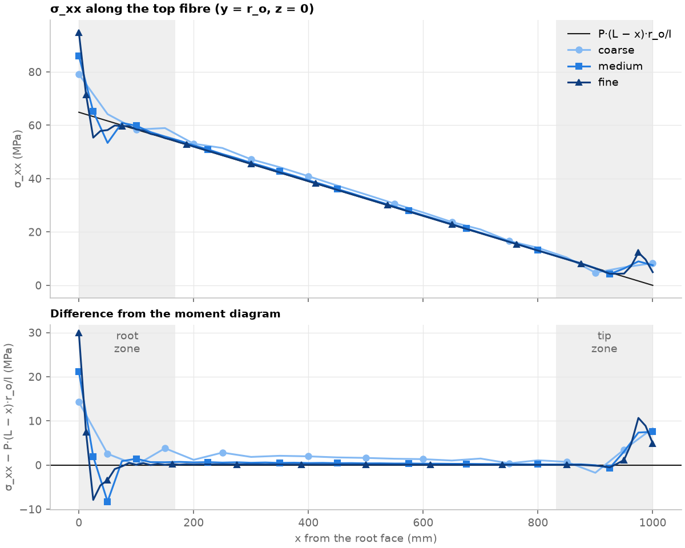
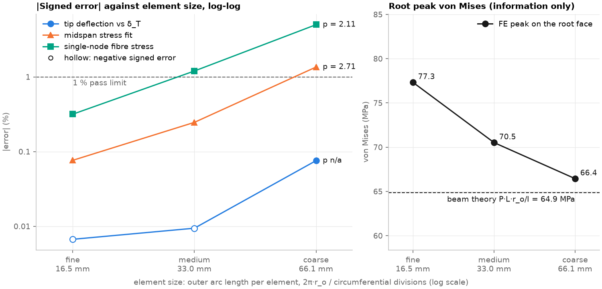

# CHS 168.3 × 8 tube cantilever benchmark figures

Generated by `python plots.py` from the solver output of `python benchmark.py`. Do not edit by hand. The numbers are in [REPORT.md](REPORT.md).

## Figure 1. Model and boundary conditions

The solid tube (coarse mesh), x along the beam, y up. The root face (x = 0, grey wall) is fixed in all three directions. The tip load P = 10000 N acts in −y on the reference node at the section centroid, and the distributing coupling (orange) spreads it over every tip-face node without stiffening the face. Bottom left: the tip face seen along the beam axis. The reference node (red ring) is an extra node in the empty middle of the tube; it is not in the `.frd`, so it is drawn at its position in the deck. Bottom right: the section at x = L/2 with the 16 midspan outer-surface nodes (green, corner and midside), over which the midspan stress fit σ_xx = a·y is taken, and the top- and bottom-fibre nodes (blue), whose single-node σ_xx is reported next to the fit. The outer-surface nodes are also marked on the whole tube at the top.

## Figure 2. Mesh levels

The mesh levels, labelled with the element counts around the circumference, through the wall and along the length (coarse 8/1/10, medium 16/2/20, fine 32/4/40). Left: the first 168.3 mm of the tube from the root face. Middle: the whole cross-section on the root face, seen along the beam axis. Right: the blue box of the middle view enlarged, at the top fibre, showing the elements through the wall thickness. All elements are 20-node C3D20R bricks whose midside nodes sit on the true arcs, so each element edge around the circumference is drawn as the quadratic curve through its midside node; the midside nodes themselves are not drawn. Every level halves the element size of the one before in all three directions. As in REPORT.md and figure 8, the node counts include the reference node.

## Figure 3. Deformed shape

Deformed shape of the fine mesh coloured by the vertical displacement u_y, with displacements scaled × 78 so that the tip drop (1.285 mm, the largest |u_y|) shows as about 10 % of L. The grey ghost is the undeformed tube. u_y is zero at the fixed root face and grows towards the tip like the deflection curve of figure 5.

## Figure 4. σ_xx and von Mises stress

σ_xx on the fine mesh, seen from above and from below, with a diverging colour map centred on zero. The hogging moment puts the top of the tube in tension (red) and the bottom in compression (blue), largest at the root and falling linearly to zero at the tip, with σ_xx changing sign across the neutral axis at the sides. The colour range is ±70 MPa, just above the beam-theory root bending stress P·L·r_o/I = 64.9 MPa. Only nodes within 12 mm of the root face go beyond it, up to ±95 MPa. Bottom: von Mises stress in the first 168.3 mm, looking at the root face. The peak of 77 MPa (blue dots) is on the outer surface where it meets the fixed root face. That is the disturbance of the fixed end, which grows from the coarse to the fine mesh level (figure 8), so the root stress is information only.

## Figure 5. Deflection along the beam

Downward deflection v(x), the mean −u_y over all nodes of each node plane, for each mesh level against the Euler-Bernoulli curve P·x²(3L − x)/(6EI) and the Timoshenko curve, which adds the shear term P·x/(κ·G·A) with Cowper's κ. The tube is short (L/D ≈ 6), so shear is 4.5 % of the tip deflection: the FE curves lie on the Timoshenko curve, while the Euler-Bernoulli curve ends 0.0577 mm short at the tip. The lower panel shows the FE difference from Timoshenko: for the fine level it rises to +0.0027 mm near the root, falls steadily to -0.0038 mm (0.30 % of δ_T) just before the tip, where the distributing coupling brings the load in, and comes back to -0.0001 mm at the tip face. At the tip the node-plane mean is the tip-face mean deflection of REPORT.md. The diamond is the reference node's tip deflection from the `.dat`, the pass/fail value (-0.007 % against δ_T).

## Figure 6. σ_xx around the circumference at midspan

Nodal σ_xx of every outer-surface node at midspan (x = L/2), corner and midside, against its height y, for each mesh level, with the beam-theory distribution M·y/I and M = P·L/2. These are the nodes of the midspan stress fit σ_xx = a·y. Plane sections stay plane: σ_xx is linear in y, zero at the neutral axis and ±32.43 MPa at the top and bottom fibres, tension at the top and compression at the bottom under the hogging moment. Nodes at the same height on either side of the section (±z) carry the same stress, so their markers overlap. The right panel shows the section discretisation error: the coarse level (8 elements around) swings about M·y/I from node to node by up to 1.62 MPa, most at the fibres (+5.0 % at the top-fibre node). The fit over all the nodes averages the swings out, which is why its error (+1.35 %) is smaller than the single-node one. The fine level differs from M·y/I by at most 0.103 MPa.

## Figure 7. σ_xx along the top fibre

Nodal σ_xx along the top fibre of the outer surface (y = r_o, z = 0) for each mesh level against the linear moment diagram σ = P·(L − x)·r_o/I. More than one diameter (D = 168.3 mm, shaded) from either end the largest difference from beam theory falls 8.4 → 1.3 → 0.4 % (coarse → medium → fine): the single-node section discretisation error of figure 6, which is about the same all along the tube. The coarse curve also swings between the corner and midside nodes of its 100 mm long elements. The shaded St-Venant zones are where the end conditions disturb the beam-theory stress: at the root the fixed face stops the lateral (Poisson) contraction, and at the tip the distributing coupling brings the load in over the tip face.

## Figure 8. Convergence against element size

Convergence against element size, one point per mesh level, on log-log axes. The element size is the arc length of one element along the outer circumference, 2π·r_o / circumferential divisions; every level halves it, along with the element size through the wall and along the length. Left: the magnitude of the signed error of each quantity against its target (hollow markers where the signed error is negative), labelled with its observed order p = ln((e_c − e_m)/(e_m − e_f)) / ln 2 from REPORT.md. The bottom-fibre errors equal the top-fibre ones (the fit gives ±a·r_o and the section is symmetric), so only the top is drawn. The midspan stress fit converges with p = 2.71 and the single-node fibre stress with p = 2.11: that is the section discretisation error falling as the circle is resolved. The deflection error (+0.076 → -0.009 → -0.007 %) is already within 0.1 % at the coarse level, changes sign and then sits on the modelling floor between the clamped solid and Timoshenko beam theory, so its order is not available. Right: the root peak von Mises stress (66.4 → 70.5 → 77.3 MPa) against the beam-theory root bending stress P·L·r_o/I = 64.9 MPa; it grows with refinement because of the fixed root face, which is why it is information only and does not enter the verdict.
